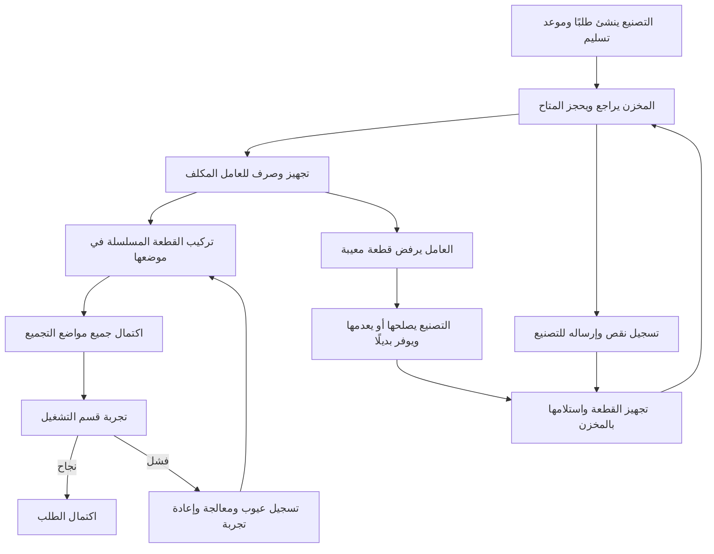

# EasyBack - نطاق التجربة الأولى

الحالة: دورة التصنيع والمخزن والتجميع والعيوب والتشغيل والتسليم منفذة، وأضيفت الورديات وجلسات الوقت والمرفقات وقوالب الفحص والتقارير وتجهيزات النشر والنسخ الاحتياطي. المرجع الحالي [تسليم باقي الـPilot](PILOT_REMAINING_STATUS.md) و[تقرير التنفيذ](FOUNDATION_STATUS.md). هذا التحديث يحل محل وصف هذه البنود كمراحل مستقبلية في الملاحظات الأقدم أدناه؛ النشر الفعلي واعتماد الاستراحات والمعايير الفنية يحتاجان موافقة وبيانات الشركة.

تحديث التشغيل 2026-10-12: بنود الفحص ومعايير النجاح تدخل لكل تجربة ولا يفترض النظام قيمًا فنية. التجربة تثبت نسخة تركيب الماكينة وكل أرقامها المسلسلة؛ الفك أو التركيب أثناءها يبطلها. الفشل يحتاج معالجة موثقة وتجربة جديدة، والنجاح يكمل الطلب دون تسجيل التسليم تلقائيًا. صلاحيات التشغيل مستقلة. الطلب المكتمل لا يعاد فتحه أو فك قطعه في النطاق الحالي؛ العمل التصحيحي بعد الإكمال مؤجل. التفاصيل في [تسليم التشغيل](OPERATIONS_STATUS.md)، وهذا التحديث يحل محل الإشارات السابقة لتأجيل التشغيل أدناه.
المرجع: [الخطة الكاملة المحدثة](EASYBACK_IMPLEMENTATION_PLAN_AR.md).

تحديث العيوب 2026-10-12: العامل يرفض القطعة المصروفة له بسبب، وتبقى في عهدته حتى استلام المخزن للمعيب فعليًا. التصنيع يسجل الإصلاح أو الإعدام؛ المصلح لا يصبح متاحًا إلا بعد استلامه وفحصه مخزنيًا، والمعدم يحتفظ برقمه وتاريخه ولا يستخدم مجددًا. شاشة البلاغات مقيدة بالنطاق والصلاحيات؛ التفاصيل في [تسليم العيوب](DEFECTS_STATUS.md).

تحديث التجميع 2026-10-12: لكل نسخة مطلوبة مهمة مستقلة وعامل مكلف وSerial مصروف؛ العامل يرى مهامه فقط. التركيب والفك يحدّثان التركيب الفعلي ونسخته مع حفظ التاريخ. اكتمال جميع النسخ ينقل الطلب إلى انتظار تجربة التشغيل وليس اكتماله؛ التفاصيل في [تسليم التجميع](ASSEMBLY_STATUS.md).

تحديث الخامات 2026-10-12: استلام وحدات خام بمقاساتها وصرفها لطلبات التجهيز والقص واستلام القطع الناتجة وحجزها للموضع المطلوب منفذ. لا نحسب سُمك سلاح القطع؛ كل باقي صالح موجب يعود للمخزن بمقاساته دون حد أدنى، والهالك الفعلي يسجل منفصلًا بسبب. القص الحالي بالطول أو شبكة مستطيلة منتظمة، وليس توزيع قص حر أو تحسينًا آليًا؛ التفاصيل في [تسليم الخامات](RAW_STOCK_STATUS.md).

تحديث الطلبات: أصبحت المسودة والتعديل وموعد التسليم وإسناد مسؤول واحد وفتح الطلب وتثبيت متطلباته والإلغاء منفذة. المسؤول بصلاحية العرض المسند يرى طلباته فقط. استلام القطع المسلسلة والحجز والصرف والمرتجعات وإرسال النواقص للتجهيز منفذة؛ التفاصيل في [تسليم الطلبات](ORDERS_STATUS.md) و[تسليم المخزن](WAREHOUSE_STATUS.md). تكليف العمال والتركيب والفك منفذة؛ تجربة التشغيل مرحلة لاحقة.

## 1. الهدف

تشغيل دورة حقيقية على مجموعة صغيرة: التصنيع ينشئ طلب ماكينة، المخزن يجهز المتاح ويرجع النقص للتصنيع، العامل المكلف يركب أو يرفض المعيب، ثم التشغيل يجرب الماكينة ويكمل الطلب بعد نجاحها. نجمع الملاحظات ونوسع المشروع حسب الاستخدام.

الحجم الكلي المعروف: حوالي 100 عامل ومدير، وحوالي 50 موديل ماكينة، ومخزن واحد. اقتراح مجموعة البداية: موديلان، ماكينتان فعليتان على الأقل، و8–10 مستخدمين يمثلون الإدارة والتصنيع والمخزن والتجميع والتشغيل. هذه أعداد تجربة مقترحة وليست أسماء حسابات تم إنشاؤها.

## 2. ما تغير عن الخطة السابقة

- قائمة قطع مستقلة لكل ماكينة فعلية، مع نسخ اختياري من موديلها دون تأثير على باقي الماكينات. هذا الجزء منفذ، ويكون مصدر متطلبات طلب التصنيع لاحقًا.
- تركيب آخر قطعة ينهي التجميع فقط وينقل الطلب إلى awaiting-testing.
- النجاح المسجل بواسطة قسم التشغيل هو شرط completed؛ الفشل يحتاج معالجة وتجربة جديدة.
- نوعا المخزون مطلوبان من أول تجربة: قطع مسلسلة بالعدد وخامات تُقص بالطول/المساحة.
- Serial وتتبع الفك والإصلاح والإعدام جزء أساسي، لا تحسين لاحق.
- العامل يرى تكليفاته فقط في الشاشة وAPI والملفات والأحداث.
- لكل عامل إيميل، والكمبيوتر والتابلت هما واجهة التشغيل المستهدفة.
- الجدول 08:00–17:00، والتمديد حتى 20:00 على وردية اليوم فقط عند الحاجة.
- زمن تركيب لكل قطعة وموعد تسليم لكل طلب ماكينة مطلوبان منذ البداية.
- مدة التوقف والاستعادة مؤجلة للنقاش بطلب المستخدم؛ لا يوجد RTO/RPO معتمد.

## 3. المسار الأساسي

إذا لم تتطلب معالجة فشل التجربة فكًا أو إعادة تركيب، تسجل المعالجة ويمكن إعادة التجربة بعد استيفاء الشروط؛ لا نفرض تركيب قطعة وهمية لاستئناف الاختبار.

## 4. حالات الطلب وحدود الإكمال

| الحالة | المعنى | الانتقال الرئيسي |
|---|---|---|
| draft | التصنيع يعد الطلب | release إلى open |
| open | الطلب لدى المخزن/التجهيز | بدء تركيب إلى in-progress |
| in-progress | التجميع جارٍ | آخر موضع مركب إلى awaiting-testing |
| awaiting-testing | التجميع كامل وينتظر التشغيل | startTest إلى testing |
| testing | تجربة على نسخة مكونات محددة | pass إلى completed، fail إلى rework |
| rework | معالجة عيوب التجربة | استيفاء التجميع والمعالجة إلى awaiting-testing |
| on-hold | إيقاف صريح بسبب مسجل | resume للحالة الملائمة بعد التحقق |
| completed | تجربة ناجحة مسجلة | يحتفظ بتاريخه؛ أعمال لاحقة منفصلة |
| cancelled | إلغاء بصلاحية وسبب | تحرير الحجز وتسوية المصروف بمساره الفعلي |

assemblyProgressPercent يحسب من المواضع المركبة حاليًا. 100% لا تعني completed. assemblyCompletedAt وtestedAt وcompletedAt حقول مختلفة. فتح/إكمال تجربة يستلزم اكتمال المواضع وعدم وجود عيب مانع.

الفك أو الاستبدال يغير configurationVersion. نتيجة اختبار على نسخة أقدم لا تكمل الطلب، حتى إذا عاد عدد القطع المركبة إلى نفس العدد؛ يجب أن تكون نتيجة الاختبار للتركيب الحالي.

## 5. القطع والمقاسات والـSerial

نفصل بين أربع هويات:

| الهوية | مثال وظيفي |
|---|---|
| partId | نوع قطعة مشترك بين موديلات |
| orderPartId | موضع/متطلب واحد في طلب ماكينة |
| serialPartId + serialNumber | القطعة الفعلية التي جرى صرفها أو تركيبها |
| stockUnitId | مصدر الخام/اللوح/القضيب أو الباقي ذي الأبعاد الفعلية |

نفس نوع القطعة يمكن أن يكرر أربع مرات في الطلب، لكن لكل مرة موضع وSerial مركب مختلف. Serial لا يكون مثبتًا في ماكينتين أو موضعين في الوقت نفسه. إصلاح نفس القطعة يحافظ على رقمها؛ استبدالها يربط قطعة جديدة ويحفظ القديمة وتاريخها.

المقاسات تستخدم أرقامًا عشرية ووحدات صريحة. الطول والعرض والقطر حقول حسب شكل الصنف. وحدات القياس والمقاسات الافتراضية لكل صنف تُدخل من عينات الشركة، ولا نفترض أن كل الأبعاد مطلوبة أو أن كل رصيد يحسب بالمتر.

## 6. المخزون ذو المسارين

### أ. القطع الجاهزة

استلام Serial -> متاح -> حجز -> صرف للعامل -> تركيب أو رفض/إرجاع. الحجز لا يخصم onHand، الصرف يخصم الرصيد ويحرر الحجز المقابل، والتركيب لا يخصم الرصيد ثانية.

الراجع المعيب يدخل quarantine إذا استلمه المخزن فعليًا، ويستبعد من available. الرصيد المتاح داخل نفس الصنف والوحدة = onHand - reserved - quarantined. القطعة عند العامل أو التصنيع لا تحسب موجودة بالمخزن لمجرد تغير حالتها. لا يجمع Serial بين quarantine وحجز صالح.

### ب. خامات الطول/المساحة

تسجيل المصدر بأبعاده ووحدته -> حجز المتطلب -> قص يدوي مسجل -> قطع ناتجة وبواقي وفاقد -> صرف المنتج المناسب. إذا كان المصدر يُصرف للتصنيع قبل القص، يسجل انتقال عهدته أولًا، ويمنع استهلاكه مرة أخرى كرصيد مخزن متاح.

عملية القص تحفظ مصدرًا محددًا ونواتج وبواقي بأبعادها وكمية الفاقد. المقادير من نفس الوحدة تتوازن حسب طريقة القياس المعتمدة، ولا نحول تلقائيًا من مساحة إلى طول. قطر قضيب أو عرض لوح قيد مواصفة وليس بديلًا عن كمية الصرف.

كل قطعة جاهزة ناتجة تحصل على Serial ومصدر تتبع، والبواقي لها stockUnitId وهوية تخزين. لا تكفي مساحة الباقي الإجمالية لقبول طلب ذي أبعاد غير قابلة للاستخراج منه. أول تسليم يدعم أشكال القص اليدوي البسيطة المثبتة بعينات الشركة، ولا يَعِد بتعشيق آلي للأشكال المعقدة.

تسجيل القص وخصم المصدر وإضافة الناتج والبواقي عملية ذرية يُمنع تنفيذها مرتين. حسب قرار 2026-10-12 لا يحسب عرض القطع بالمنشار ضمن الهالك؛ كل باقي صالح موجب يرجع دون حد أدنى. الهالك الفعلي يسجل بسبب منفصل ولا يدخل رصيدًا صالحًا.

نطاق التصنيع يبقى متابعة تجهيز/إصلاح؛ تتبع قص الخامة لا يضيف محاسبة تكلفة أو تخطيط مواد شراء.

## 7. الرفض والإصلاح والإعدام والفك

- العامل المكلف يحدد Serial المعيب والسبب، ويوقف استخدامه. الصورة اختيارية في pilot.
- التصنيع يسجل إصلاحًا أو إعدامًا مع السبب والمنفذ، وفق صلاحية منحها المدير.
- القطعة المصلحة تعود خلال استلام مخزني فعلي وتخصيص/صرف جديد، ولا تقفز تلقائيًا إلى installed.
- Serial المعدم يحتفظ بسجله ويمنع استخدامه؛ لا يعاد الرقم لقطعة بديلة.
- اقتراح استمرار تركيب المواضع السليمة المستقلة أثناء المعالجة، مع منع تجربة نهائية ناجحة قبل معالجة العجز/العيب.
- الفك يغلق machine_installation الحالي ويسجل removedAt وremovedBy والسبب والمصير ويحدث حالة الموضع على الماكينة.
- الفك قبل نجاح التشغيل يخفض التقدم ويلغي جاهزية الاختبار. الفك بعد إكمال سابق يحفظ التاريخ السابق ويحدث الحالة الحالية، مع تكليف عمل تصحيحي وصلاحية واضحة.
- الإلغاء لا يحتاج اعتماد جودة، ويحرر غير المصروف فقط؛ ما خرج من المخزن يحتاج إرجاعًا فعليًا أو إثبات تركيب/إعدام.

## 8. الزمن والتسليم

expectedInstallMinutes ينسخ من BOM إلى موضع الطلب؛ تقبل الواجهة ساعات أو دقائق وتحفظ القيمة الموحّدة بالدقائق. البدء والإيقاف المؤقت والاستئناف والانتهاء تسجل work_sessions لكل محاولة، مع إبقاء زمن الانتظار والإصلاح منفصلين.

الوردية المعتادة 08:00–17:00. التمديد حتى 20:00 يسجل على يومه ولا يغير كل الأيام. أيام الراحة والاستراحات وصلاحية تمديد الوردية تفاصيل تضبط قبل حساب زمن العمل المتاح؛ لا يحسب النظام ساعات الليل على أنها زمن تركيب.

requiredDeliveryAt يدخل عند إنشاء التصنيع للطلب، وأي تغيير له مسجل. تأخير الطلب يقاس مقابل نجاح التشغيل وتاريخ اكتماله، بينما lateAssembly مؤشر منفصل. التقارير لا تخلط زمن إنتاج قطعة مع زمن تركيبها.

## 9. أقل مجموعة شاشات عملية

1. الدخول بإيميل والحسابات والأدوار والصلاحيات والتعيين.
2. الموديلات والماكينات وقائمة BOM والمقاسات وزمن التركيب.
3. التصنيع: إنشاء طلب وموعد تسليمه، قائمة النقص والإصلاح والإعدام.
4. المخزن: جاهز/ناقص، قطع Serial، مصادر الخام والقص والبواقي، استلام وحجز وصرف وإرجاع.
5. العامل: طلباتي، المقاسات والـSerial والموضع، بدء/إيقاف/تركيب/رفض/فك.
6. التشغيل: انتظار التجربة، بدءها، نجاح أو فشل وعيوب ومعالجة ثم إعادة التجربة.
7. المدير: حالة الطلبات، العجز والعيوب، تقدم التجميع مقابل حالة التجربة، والتسليم المتوقع والفعلي.

واجهة ويب للكمبيوتر والتابلت، عربية من البداية ومهيأة للإنجليزية. كل worker list/detail/API/file access يتحقق من order assignment. لا تظهر طلبات الآخرين في البحث أو الإشعارات حتى لو عرف المستخدم الـID.

## 10. تسليمات صغيرة متتابعة

| التسليم | المحتوى | معيار القبول |
|---|---|---|
| A. تصميم عينة | ERD مبسط، حالات طلب وتشغيل، permissions، نموذج مخزون counted/measured، عينات موديلين | تفسير نوع القطعة وموضعها وSerial ومصدر الخام بلا خلط |
| B. حسابات وطلبات | Spring Boot/PostgreSQL/React، auth وصلاحيات وتعيين، موديلات وBOM، إنشاء التصنيع للطلب وموعده | العامل لا يقرأ تكليف غيره، والتصنيع يرسل للمخزن |
| C. تجهيز ومخزون | قطع مسلسلة وخامات مقاسة وقص وبواقي، جاهز/ناقص ومهام التصنيع، الحجز والصرف | لا صرف مزدوج، ولا قص غير متوازن، وكل ناتج مرتبط بمصدره |
| D. دورة تنفيذ | تركيب وزمن ورفض وإصلاح/إعدام وفك، وتجارب تشغيل ناجحة وفاشلة | لا completed بتركيب آخر قطعة؛ النجاح التشغيلي فقط يكمل |
| E. Pilot داخلي | شاشات مكتملة للأدوار، audit وتحديث الحالة، بيانات عينة، تجربة 8–10 مستخدمين | الأقسام تنفذ دورة فعلية وتسجل الملاحظات وإعادة الاختبار |
| F. توسع حسب القياس | بقية الموديلات والمستخدمين، ملفات 3D محسنة، تقارير متقدمة ودخول بعيد | التوسع على أساس الاحتياج وقياس الأداء واختبار backup/network |

C يشمل نوعي المخزون قبل pilot؛ لا يؤجل الخام المقاس كأنه اختيار لم يطلبه المستخدم. واجهة كل وظيفة تُنفذ مع تسليمها. توصيل التحديث اللحظي يمكن إضافته عند E؛ إعادة القراءة من السيرفر تكفي لاختبارات الوظائف المبكرة.

التنفيذ المقترح Modular Monolith وسيرفر واحد وDocker Compose. لا حاجة حالية لـKubernetes. إدخال بيانات تشغيل فعلية يحتاج سياسة backup مجرّبة حتى لو كانت أهداف RTO/RPO التفصيلية مؤجلة الآن.

## 11. سيناريو قبول شامل

1. التصنيع ينشئ طلبًا بموعد تسليم ومكون مكرر، وعيّنه لعامل محدد.
2. المخزن يحجز Serial متاحًا ويسجل نقصًا لموضع آخر؛ تنشأ مهمة تجهيز واحدة رغم تكرار إرسال الطلب.
3. يسجل صرف/قص مصدر خام، وناتجًا مسلسلاً وبواقي وفاقدًا بوحدات صحيحة، ثم يستلم ويصرف الناتج.
4. العامل يبدأ زمن التركيب، ويرفض أحد الـSerials بسبب عيب، والتصنيع يسجل إصلاحًا أو إعدامًا وبديلًا.
5. تراجع الشاشة تاريخ نفس الـSerial المصلح أو البديل الجديد، وحركة المخزن دون زيادة/خصم مزدوج.
6. يركب العامل القطع، ثم يفك واحدة؛ تظهر غير مركبة على الماكينة، ويقل التقدم وتبقى حركتها وتاريخها.
7. بعد إعادة التركيب تبلغ نسبة التجميع 100% وتظل حالة الطلب awaiting-testing.
8. التشغيل يسجل فشلًا وعيبًا، تسجل المعالجة، ثم تجرى تجربة جديدة ناجحة للنسخة الحالية.
9. عند النجاح فقط يسجل completedAt، مع وقت التجميع ووقت التجربة والتأخير مقابل موعد التسليم.
10. مستخدم غير مكلف يحاول قراءة/تعديل نفس الطلب عبر API ويُمنع. يبطل serial scrapped أو serial مستخدم في ماكينة أخرى، وتعارض تركيب أثناء تجربة يمنع نجاح نتيجة قديمة.

## 12. المؤجل والتفاصيل المتبقية

مؤجل للتوسع: عرض المصنع 3D كاملًا ورسومات جميع الموديلات، الشات الكامل، التصدير والتحليلات المتقدمة، تطبيق هاتف مستقل، المحاسبة والتكلفة والمشتريات، تعدد المخازن، التشغيل offline، والتوزيع على عدة سيرفرات.

قبل C نحتاج عينات وحدات الصرف وأشكال القص والبواقي والفاقد الحالية، وطريقة Serial. قبل D نحدد بنود تجربة التشغيل وأيام الراحة والاستراحات وصاحب صلاحية التعيين والتمديد والإعدام. قبل pilot نختار أسماء الأفراد والموديلين وتجهيز الحسابات؛ قبل الدخول البعيد تثبت الشبكة وDNS وVPN وMFA. مدة التوقف تناقش لاحقًا كما طلب المستخدم.

لا يوجد كود Java أو React منفذ ضمن هذه الوثيقة. هي تثبيت نطاق وتسليمات ومعايير قبول للتجربة الصغيرة قبل التوسع.
